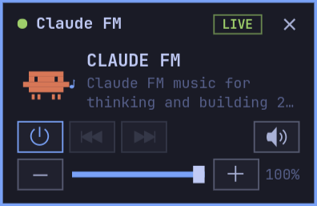

# Claude FM (MiniTube)

Omarchy 바의 트레이에 사는 작은 라디오. YouTube 라이브 스트림([Claude FM](https://www.youtube.com/live/tRsQsTMvPNg))을 mpv로 재생하고, 팝업은 현재 Omarchy 테마의 색과 폰트를 따라간다.



- 단일 파일(`minitube.py`). 표준 라이브러리 + PyGObject(GTK4) + pycairo만 쓴다.
- 트레이는 StatusNotifierItem과 dbusmenu를 Gio로 직접 구현했다(libappindicator 불필요).
- 테마를 바꾸면(`omarchy theme set …`) 팝업과 트레이 아이콘이 바로 다시 칠해진다.
- Claude Code 마스코트가 재생 중엔 들썩이고, 꺼지면 잔다.

## 요구 사항

Omarchy(Hyprland + Omarchy 셸 바)에서 아래 버전으로 확인했다.

| 패키지 | 확인한 버전 |
|---|---|
| gtk4 | 4.24.1 |
| python-gobject | 3.58.1 |
| python-cairo | 1.29.2 |
| mpv | 0.41.0 |
| yt-dlp | 2026.08.19 |

Python 3.11 이상이 필요하다(`tomllib`). 트레이 호스트(StatusNotifierWatcher)가 없는 환경에서는 트레이 대신 창을 바로 띄운다.

## 설치

리포를 `~/work/minitube`에 둔다고 가정한다. `bin/minitube`가 이 경로를 절대경로로 실행하므로, 다른 곳에 두면 그 줄도 고친다.

```sh
git clone https://github.com/bradhjjo/minitube ~/work/minitube
cd ~/work/minitube

# 런처, 데스크톱 엔트리, 아이콘 (리포를 가리키는 심볼릭 링크)
ln -sfn "$PWD/bin/minitube" ~/.local/bin/minitube
ln -sfn "$PWD/share/applications/minitube.desktop" ~/.local/share/applications/minitube.desktop
mkdir -p ~/.local/share/icons/hicolor/scalable/apps
ln -sfn "$PWD/share/icons/hicolor/scalable/apps/minitube.svg" ~/.local/share/icons/hicolor/scalable/apps/minitube.svg
update-desktop-database ~/.local/share/applications
gtk-update-icon-cache -f -t ~/.local/share/icons/hicolor   # 캐시가 있으면 갱신해야 아이콘이 잡힌다
```

### Hyprland 창 규칙 (`~/.config/hypr/hyprland.lua`)

팝업을 바의 트레이 아래 오른쪽 위에, 모든 워크스페이스에, 불투명하게 띄운다. Omarchy 기본 `default-opacity`(0.985/0.96)를 빼지 않으면 뒤 창이 비쳐 보인다.

```lua
o.window({ class = "^io\\.github\\.minitube$" }, {
  tag = "-default-opacity",
  opacity = "1 1",
  float = true,
  pin = true,
  move = { "(monitor_w-window_w-10)", "(monitor_h*0+34)" },
})
```

`34`는 바 높이(26) + 여백이다. 수정한 뒤에는 `hyprctl reload && hyprctl configerrors`로 확인한다.

### 트레이에 고정 (`~/.config/omarchy/shell.json`)

새 트레이 항목은 바의 서랍(`<`) 안에 숨는다. 항상 보이게 하려면 `omarchy.tray` 항목에 id `minitube`를 핀으로 넣는다. 서랍을 오른쪽 클릭해서 나오는 관리 메뉴로 해도 같다.

```json
{
  "id": "omarchy.tray",
  "pinned": ["minitube"],
  "hidden": []
}
```

### 로그인 시 자동 실행 (`~/.config/hypr/autostart.lua`)

```lua
o.launch_on_start("minitube --tray")
```

`--tray`로 켜면 재생하지 않고 트레이에서 조용히 기다린다.

## 사용법

```sh
minitube          # 트레이에 뜨고 바로 재생
minitube --tray   # 재생 없이 트레이에서 대기 (자동 실행용)
```

이미 실행 중일 때 다시 실행하면 팝업이 열린다.

| 트레이 아이콘 | 동작 |
|---|---|
| 왼쪽 클릭 | 팝업 열기/닫기 |
| 가운데 클릭 | 전원 켜기/끄기 |
| 휠 | 볼륨 ±5 |
| 오른쪽 클릭 | 메뉴: Show/Hide radio · Power · Mute · Quit |

| 팝업 키 | 동작 |
|---|---|
| Space / Enter | 전원 |
| ← / → | 이전 / 다음 스테이션 |
| ↑ / ↓ (+ / −) | 볼륨 ±5 |
| M | 음소거 |
| Q / Esc | 팝업 숨기기 (재생은 계속) |
| Ctrl+Q | 종료 |

팝업 위에서 휠을 굴려도 볼륨이 바뀐다. 팝업을 닫아도 소리는 계속 나고, 앱은 Ctrl+Q, 트레이 메뉴의 Quit, SIGTERM/SIGINT/SIGHUP으로 끝난다. 어느 쪽으로 끝내도 mpv까지 같이 정리된다.

## 설정

`~/.config/minitube/` (`$XDG_CONFIG_HOME`을 따른다)

- `stations.json`: 스테이션 목록. 처음 실행할 때 Claude FM 하나로 만들어진다. mpv와 yt-dlp가 여는 URL이면 무엇이든 추가할 수 있다.

  ```json
  {
    "stations": [
      {"name": "CLAUDE FM", "url": "https://www.youtube.com/live/tRsQsTMvPNg"}
    ]
  }
  ```

- `state.json`: 마지막 볼륨과 스테이션. 앱이 직접 저장한다.

## 동작 방식

- 오디오는 `mpv --no-video --idle=yes`가 맡고, 앱은 `$XDG_RUNTIME_DIR/minitube-<pid>.sock` JSON IPC로 제어한다. 라이브가 끊기면 다시 불러온다.
- 테마는 `~/.local/state/omarchy/current/theme/`의 `colors.toml`과 `shell.toml`(popups/controls 토큰)에서, 폰트는 `fc-match monospace`에서 읽는다. 테마 변경은 파일 감시로 알아챈다.
- 팝업이 숨겨져 있으면 애니메이션을 멈춘다. 이 머신(Intel iGPU)에서 잰 CPU는 트레이에 숨긴 상태 약 0.6%, 팝업을 띄우고 재생 중 약 2.7%였다.
- `GSK_RENDERER`를 따로 지정하지 않으면 `gl`을 쓴다. 이 머신에서 기본값(vulkan)의 절반 정도 CPU를 썼다.

## 테스트

마우스나 키 입력을 주입하지 않는다. 각 테스트는 임시 `XDG_CONFIG_HOME`(스테이션 2개)을 만들어 쓰므로 실제 설정을 건드리지 않는다. 앱이 단일 인스턴스라서 **실행 중인 MiniTube를 먼저 끄고** 하나씩 돌린다. 스트림을 실제로 재생하므로 네트워크가 필요하다.

```sh
python3 tests/test_tray.py   # 트레이 D-Bus(Activate/SecondaryActivate/Scroll/메뉴), 종료, SIGTERM, --tray
python3 tests/test_ui.py     # 팝업 위젯을 in-process로 구동 + mpv IPC 확인 + grim 스크린샷
```

각 체크마다 `PASS`/`FAIL`을 한 줄씩 찍고, 모두 통과하면 종료 코드 0을 돌려준다. `test_ui.py`는 Hyprland(`hyprctl`)와 `grim`이 있어야 한다.

## 라이선스

[MIT](LICENSE) © 2026 Brad Jo

Claude, Claude Code와 Claude Code 마스코트는 Anthropic의 상표이자 저작물이며, 이 라이선스의 대상이 아니다. 이 리포는 Anthropic과 무관한 개인 프로젝트다.
